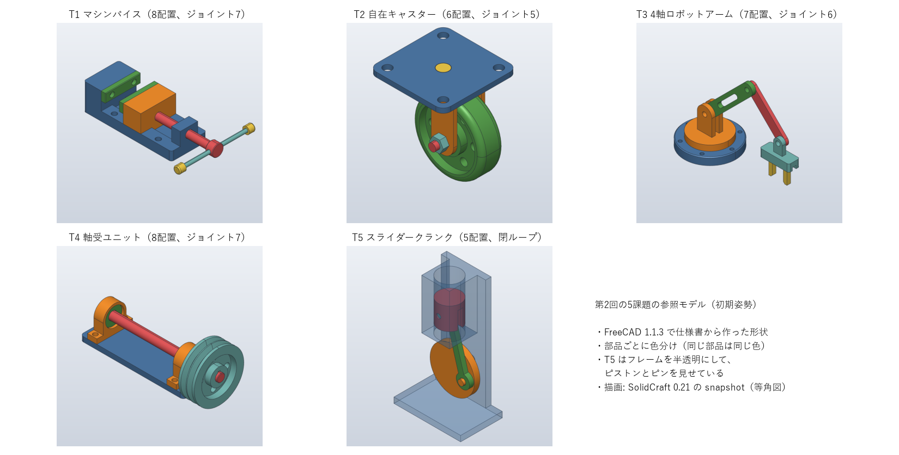

# cad-mcp-token-bench

AI エージェントに CAD の MCP サーバーを使わせて、機械のアセンブリを5つ作らせ、使ったトークンの合計を測るキットです。課題文と数え方を固定しているので、CAD どうしを比べられます。

4つの CAD を測定済みです。このキットを使うと、ほかの CAD の MCP サーバーを同じ条件で測れます。

## 測定済みの結果

5課題の合計トークンの中央値です。単位は万トークン。

| CAD | Claude Code（Opus 5.5） | Codex CLI（GPT-6.1-Sol） |
|---|---|---|
| Autodesk Fusion | 27.0 | 46.7 |
| FreeCAD | 58.0 | 60.1 |
| SolidCraft | 100.8 | 71.6 |
| ZW3D | 321.9 | 131.4 |

- どのマスも課題ごとに1回だけ測った参考値です。
- Claude Code と Codex CLI は、モデルもトークンの区切り方も違います。列どうしは比べないでください。
- 測った日は、Fusion、FreeCAD、SolidCraft が 2026-10-28、ZW3D が 2026-11-20 です。
- 課題ごとの値、成否、呼び出しの回数、バージョンは [results/measured.csv](results/measured.csv) にあります。

## 課題



| 課題 | 作るもの | 部品の数 | ジョイントの数 |
|---|---|---|---|
| T1 | マシンバイス（万力） | 8 | 7 |
| T2 | 自在キャスター | 6 | 5 |
| T3 | 4軸ロボットアーム（2本指グリッパー付き） | 7 | 6 |
| T4 | 軸受ユニット（ピローブロック＋Vプーリー） | 8 | 7 |
| T5 | スライダークランク（単気筒エンジンの模型） | 5 | 5 |

AI に渡すのは文章の仕様書だけです。画像は渡しません。仕様書と参照モデルは [tasks/](tasks/) にあります。

## 測り方

1. CAD の設定ファイルを書く。
2. 立方体1個の課題で、接続を確かめる。
3. 5課題を1回ずつ実行する。
4. できたモデルを確かめる。
5. 集計して、結果を送る。

```
python tools/bench.py run --cad cads/mycad.json --agent claude --task plumbing
python tools/bench.py run --cad cads/mycad.json --agent claude --task T1
python tools/bench.py summary --cad cads/mycad.json
```

くわしい手順は [docs/procedure.md](docs/procedure.md)、そろえる条件と数え方は [docs/rules.md](docs/rules.md) にあります。

## 必要なもの

- Python 3.9 以上（標準ライブラリだけで動きます）
- Claude Code。Codex CLI でも測るなら Codex CLI
- 測りたい CAD と、その MCP サーバー
- できたモデルを STEP で検査するなら FreeCAD 1.1

動作は Windows 11 で確かめています。

## 使うトークンの目安

測定済みの CAD では1課題あたり 21万〜358万トークンでした。5課題の合計は、Claude Code が 144万〜1,539万トークン、Codex CLI が 238万〜886万トークンです。実行すると、契約しているプランの利用枠か API の料金を使います。

## フォルダーの構成

| 場所 | 中身 |
|---|---|
| [docs/procedure.md](docs/procedure.md) | 手順 |
| [docs/rules.md](docs/rules.md) | そろえる条件、トークンの数え方、成否の判定 |
| [prompts/template.md](prompts/template.md) | 課題文のひな形 |
| [tasks/](tasks/) | 課題の仕様書、参照モデル（STEP）、基準値 |
| [cads/](cads/) | CAD の設定。測定済みの4つと、書き方の例 |
| [tools/bench.py](tools/bench.py) | 実行、数え直し、検査、集計 |
| [tools/check_step.py](tools/check_step.py) | STEP と参照モデルの比較（FreeCAD の中で動く） |
| [results/measured.csv](results/measured.csv) | 測定済みの 40 回の結果 |
| `results/raw/` | 実行の記録（git に入れません） |
| `results/submitted/` | 送ってもらった結果 |

## 結果の送り方

Pull Request で次の2つを送ってください。

- `cads/<id>.json`（CAD の設定）。PC に固有のパスは `C:/path/to/...` に書き換えます。
- `results/submitted/<id>.csv`（`summary` が書き出す表）。

実行の記録（`results/raw/`）は送らないでください。Claude Code の起動の記録や MCP サーバーの出力に、PC のユーザー名を含むパスが入っていることがあります。

## ライセンス

- コード（`tools/`）は MIT License です（[LICENSE](LICENSE)）。
- 課題、課題文、文書、結果（`tasks/`、`prompts/`、`docs/`、`results/`）は [CC BY 4.0](https://creativecommons.org/licenses/by/4.0/deed.ja) です。

CAD の名前はそれぞれの会社や団体の商標です。
